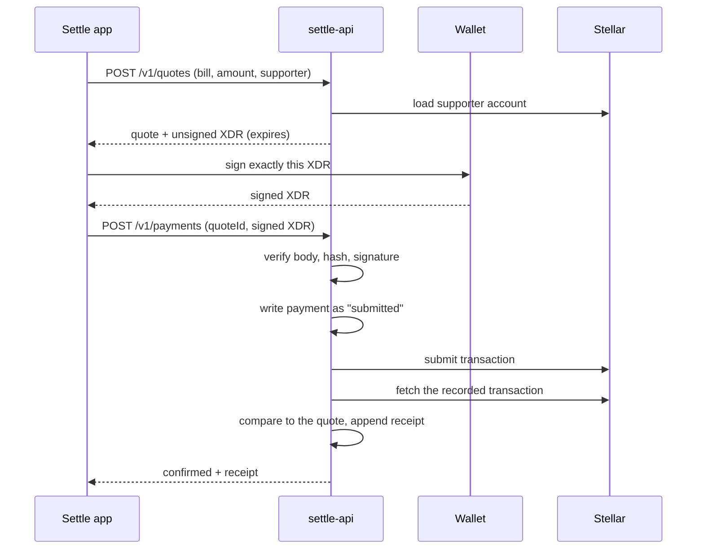

<div align="center">

# SETTLE API

### Verified quotes. Unsigned payments. Independent confirmation. A receipt you can check.

The testnet settlement service behind [Settle](https://github.com/Anasabubakar/settle): it turns a bill and an amount into a fee-disclosed, expiring Stellar payment that a wallet signs, then proves what happened.

<p>
  <a href="https://github.com/Anasabubakar/settle-api/actions"></a>
  <a href="LICENSE"></a>
  <a href="CONTRIBUTING.md"></a>
</p>

<p>
  
  
  
  
  
</p>

<a href="#quick-start">Quick start</a> · <a href="#how-it-works">How it works</a> · <a href="openapi.yaml">API contract</a> · <a href="docs/threat-model.md">Threat model</a> · <a href="docs/testnet-evidence.md">Testnet evidence</a> · <a href="CONTRIBUTING.md">Contributing</a>

</div>

---

## What is this?

Settle lets a supporter fund part or all of a verified bill, paid **directly to the provider**. The app never holds a key, picks a destination, or decides what a bill is worth. This service is the server side of that promise:

1. **Quote.** The supporter names a bill and an amount. The server resolves the provider's destination, converts fiat to USDC at a disclosed rate, checks the supporter's account, reserves the amount, and returns an **unsigned** Stellar transaction.
2. **Sign.** The supporter's wallet signs exactly that transaction.
3. **Submit.** The server checks the signed transaction is *byte-for-byte* what it built, writes the payment down, and sends it to Stellar.
4. **Confirm.** The server re-reads the transaction from the network and compares it to the quote. Only a match produces a receipt.

> **Testnet only.** This service refuses to start on any other network. There is no real provider directory, no market rate source and no compliance process behind it. See [what is and is not real](#what-is-real-and-what-is-not).

## Why it is safe to build on

| Guarantee | How it is enforced | Where it is tested |
|---|---|---|
| The client cannot choose who is paid | A request carrying `destination`, `assetIssuer`, `providerId`, `rate`, `fee`, `memo` or `network` is refused | `tests/quotes.test.ts` |
| The wallet signs only what the server built | Field-by-field checks plus a transaction-hash equality check, before anything reaches the network | `tests/payments.test.ts` (13 tamper cases) |
| A retry can never pay twice | Required `Idempotency-Key`, single-use quotes, write-ahead payment records | `tests/payments.test.ts` |
| "Confirmed" means confirmed | The recorded transaction is fetched and compared to the quote; a mismatch is a failure with no receipt | `tests/payments.test.ts` |
| An expired transaction can never land | The transaction's own time bound equals the quote's expiry | `tests/payments.test.ts` |
| Two supporters cannot both claim the last of a bill | Open quotes and in-flight payments are reserved against the bill | `tests/quotes.test.ts` |
| Receipts cannot be quietly edited | Append-only, hash-chained ledger that fails closed on load if it does not verify | `tests/ledger.test.ts` |
| The docs match the code | A test fails if `openapi.yaml` and the router disagree | `tests/contract.test.ts` |
| It works on the real network | A script settles a real testnet payment and checks balances on Horizon | `scripts/e2e-testnet.ts` |

## Quick start

Requires Node 22.18+ (Node 24 recommended, which runs TypeScript directly).

```bash
git clone https://github.com/Anasabubakar/settle-api.git
cd settle-api
npm install
cp .env.example .env     # then set SETTLE_USDC_ISSUER
npm run check            # typecheck + 140 tests
```

Run it:

```bash
export SETTLE_USDC_ISSUER=<testnet USDC issuer>   # required, never defaulted
npm start
curl localhost:8787/healthz
curl localhost:8787/v1/bills
```

Prove it against the real Stellar testnet (creates throwaway accounts and a self-issued test asset):

```bash
npm run e2e:testnet
```

## API

The full contract, with schemas and error codes, is [`openapi.yaml`](openapi.yaml).

| Method | Path | Purpose |
|---|---|---|
| `POST` | `/v1/quotes` | Verified, expiring quote and an unsigned XDR |
| `GET` | `/v1/quotes/{quoteId}` | Read a quote, including expiry |
| `POST` | `/v1/payments` | Submit the signed transaction |
| `GET` | `/v1/payments/{paymentId}` | Status; polling also drives confirmation |
| `GET` | `/v1/receipts/{receiptId}` | A hash-chained receipt |
| `GET` | `/v1/ledger` | Ledger head and whether the chain verifies |
| `GET` | `/v1/bills`, `/v1/bills/{billId}` | Server-side funded, reserved and remaining amounts |
| `GET` | `/v1/config`, `/healthz` | Network configuration, liveness |

Every `POST` needs an `Idempotency-Key`. Every error has the same shape: `{ "error": { "code", "message", "details?", "requestId" } }`.

```jsonc
// POST /v1/quotes
{ "billId": "bill-maya-prescription", "amountMinor": 1000, "currency": "USD",
  "sourceAccount": "G…" }        // the supporter's own account; nothing else is accepted
```

## How it works



See [`docs/architecture.md`](docs/architecture.md) for the state machines, idempotency and recovery design.

## What is real, and what is not

| | Status |
|---|---|
| Quote → signature check → submission → independent confirmation → receipt | ✅ Real, tested, and run against the live testnet |
| Idempotency, expiry, single-use quotes, bill reservations, crash recovery | ✅ Real and tested |
| Hash-chained receipt ledger | ✅ Real and tested |
| Provider directory | 🟡 **Fixtures.** Testnet accounts that belong to no provider |
| Exchange rates | 🟡 **Fixtures.** Illustrative values, labelled `testnet-fixture`, not market data |
| Authentication and identity | 🔴 Not built. Quote endpoints are unauthenticated and bounded by rate limits and bill totals |
| Storage | 🟡 A snapshot file. Fine for a pilot; production needs a database |
| Mainnet | 🔴 Disabled in code. Needs verified providers, a real rate source, compliance review and an audit |

## Project layout

| Path | Purpose |
|---|---|
| `src/service.ts` | Quotes, payments, confirmation, reconciliation, idempotency |
| `src/payload.ts` | The two checks that make "the wallet signs only what the server built" true |
| `src/ledger.ts` | Append-only, hash-chained receipts |
| `src/chain.ts` | The Stellar network behind an interface, plus the Horizon client |
| `src/http.ts` | Router, limits, CORS, rate limiting, one error shape |
| `src/money.ts` | Integer-only fiat ↔ USDC arithmetic |
| `data/` | Testnet fixture providers and bills |
| `openapi.yaml` | The API contract |
| `docs/` | Architecture, threat model, testnet evidence |

## Roadmap

- [x] Settlement API contract and testnet implementation
- [x] Idempotent submission, independent confirmation, receipt ledger
- [x] Live testnet proof
- [ ] Authentication and per-supporter limits
- [ ] Database storage and an observer run as its own process
- [ ] Verified provider onboarding and destination-ownership proof
- [ ] A real, audited rate source with a lock
- [ ] Security and compliance review, closed pilot, and a mainnet decision

## Contributing

Read [CONTRIBUTING.md](CONTRIBUTING.md) and follow the [Code of Conduct](CODE_OF_CONDUCT.md). Do not report vulnerabilities in a public issue; see [SECURITY.md](SECURITY.md).

## License

MIT © 2026 Anas Abubakar. See [LICENSE](LICENSE).
