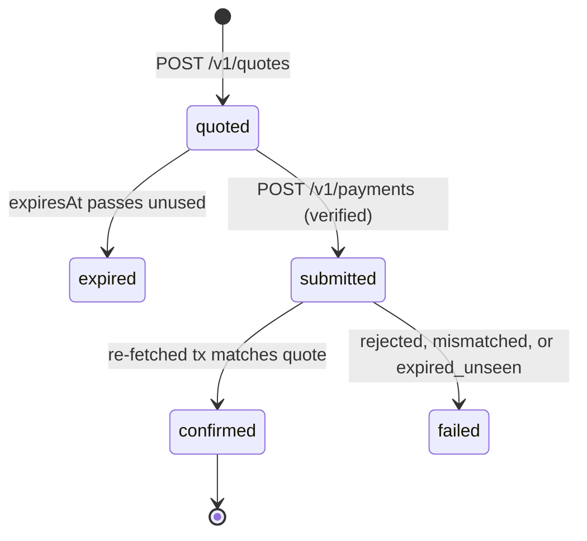

# Architecture

settle-api is a small, dependency-light service (Node, TypeScript run directly, `@stellar/stellar-sdk` only) with one job: turn a verified bill and an amount into a Stellar payment that the supporter's wallet signs, then prove what happened.

## Components

| Module | Responsibility |
|---|---|
| `http.ts` | Routing, body limit (64 KB), JSON only, rate limiting, CORS allow-list, one error shape |
| `service.ts` | Quote, submit, confirm, reconcile; idempotency; bill reservations |
| `payload.ts` | Verifies a signed transaction is exactly what was quoted; verifies a confirmed transaction matches the quote |
| `chain.ts` | `ChainClient` interface (`loadAccount`, `submitTransaction`, `fetchTransaction`) and its Horizon implementation |
| `ledger.ts` | Append-only, hash-chained receipts |
| `store.ts` | Quotes, payments, idempotency records; atomic snapshot persistence |
| `directory.ts` | Provider and bill fixtures with strict validation |
| `money.ts` | Integer-only fiat minor units ↔ USDC stroops, rounding up |
| `config.ts` | Environment validation; refuses to start off testnet |

The chain sits behind an interface so every failure mode (timeouts, a transaction that never appears, a tampered record) is testable without a network.

## Payment state machine

A quote is single-use. A payment is written as `submitted` **before** the network call, so a crash between the two leaves a record the observer can resolve rather than a payment nobody knows about.

## Why a payment cannot be paid twice or land late

- **Idempotency.** Every `POST` requires an `Idempotency-Key`. The key is bound to a fingerprint of the request; the same key with a different body is a `409`, the same key with the same body replays the stored result.
- **Single-use quotes.** A second submission for the same quote returns the existing payment.
- **Time bound = expiry.** The transaction's `maxTime` equals the quote's `expiresAt`. After that moment plus a grace period, a transaction that was never seen on the network can never be accepted, so it is failed as `expired_unseen` and the reservation is released.

## Confirmation is independent

Submission success is not trusted. After a transaction is recorded the service fetches it from the network and compares source, destination, asset, issuer, amount, memo and success flag with the quote. Only then is a receipt appended. A mismatch is a failure with no receipt.

## Bill accounting

`remaining = total − funded − reserved`, where reserved is open quotes plus submitted payments. This stops two supporters from both being quoted the last of a bill, and releases the hold on expiry or failure.

## Receipt ledger

Each receipt stores `previousHash` and `hash = sha256(canonicalJson(receipt body ∥ previousHash))`. `verify()` walks the chain; the service refuses to load a ledger file that fails verification and `GET /v1/ledger` reports the head and validity. This is tamper-evident, not tamper-proof: it detects edits, it does not prevent deletion of the whole file.

## Money

Fiat amounts are integer minor units, USDC amounts are integer stroops (7 decimals). Conversion uses `BigInt` and rounds **up**, so the provider is never underpaid by rounding. Rates here are fixtures labelled `testnet-fixture`.

## Out of scope (deliberately)

Soroban, path payments, authentication, a database, KYC/AML, provider onboarding, and any mainnet code path.
